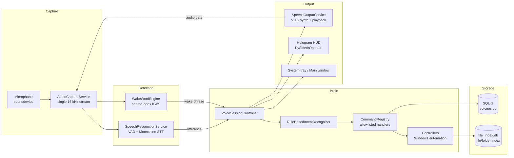

# VoiceOS — Offline-First Desktop Voice Assistant

## Overview

VoiceOS is a Windows desktop voice assistant ("Jarvis") with an
offline-first speech pipeline. It listens for the wake phrase
**"Hello Jarvis"**, transcribes spoken commands with a local speech
model, routes them to a safe allowlisted command registry, and answers
by synthesized voice. KWS, STT, TTS and intent recognition run locally;
the optional `SEARCH_WEB` command opens an external search in the
default browser and requires an internet connection.

A holographic HUD (OpenGL orb rendered by PySide6) visualizes the
assistant's state on a secondary display, and a system-tray interface
provides control without a main window.

> **Status:** Windows 11 x64 only. Developed and physically verified on
> a laptop with Intel array + Realtek headset microphones and two
> monitors. See [docs/KNOWN_LIMITATIONS.md](docs/KNOWN_LIMITATIONS.md)
> for verification status of individual features.

## Features

- **Wake-word detection** — sherpa-onnx Zipformer KWS (GigaSpeech
  3.3M), custom keyword spotter for "Hello Jarvis" with pronunciation
  variants; runs on a dedicated worker thread.
- **Offline STT** — Moonshine Base INT8 via sherpa-onnx
  `OfflineRecognizer`, adaptive VAD with noise-floor calibration,
  pre-roll and hangover endpointing.
- **Offline TTS** — sherpa-onnx VITS/Piper (`en_US-lessac-medium-int8`)
  with `lexicon-en-us.txt`; full/quick/silent acknowledgement modes.
- **Voice sessions** — 60 s inactivity timeout (configurable),
  "Goodbye Jarvis" exit phrase, suspend/resume handling, single
  microphone stream shared by KWS and STT.
- **Command handling** — offline rule-based intent recognizer plus an
  allowlisted handler registry: open/switch/close/focus/minimize/
  maximize/restore applications, list running/installed apps, open
  folders and files, local file/folder search (persistent SQLite
  index), web search, monitor list/move/open-on-monitor, volume,
  lock, battery/network/screenshot/notification status, Windows power
  management (sleep/shutdown/restart with spoken confirmation and
  countdown cancellation), desktop/window controls (minimize, restore,
  close, switch, virtual-desktop and snap), and fuzzy misheard-command
  recovery.
- **Windows integration** — per-user Startup folder registration,
  single-instance named-mutex lock, system tray with status and
  controls, hide-to-tray window.
- **Holographic HUD** — compact always-on-top OpenGL orb (~30 FPS
  target) with state, level, transcript and session visualization;
  multi-monitor placement with fallback.
- **Audio handling** — normal runtime processing keeps microphone
  frames in memory and does not automatically save raw audio. Explicit
  evaluation and diagnostic utilities can create WAV captures; see
  [docs/DATA_PRIVACY.md](docs/DATA_PRIVACY.md).
- **Local history** — recognized transcripts, command types and outcomes
  are stored in the local history database.
- **Data handling** — the repository contains recorded WAV test fixtures;
  review [docs/DATA_PRIVACY.md](docs/DATA_PRIVACY.md) before adding or
  redistributing recordings.

## Architecture



Key design points:

- **One microphone stream** feeds both KWS (standby) and STT
  (session). The stream is restarted safely on device changes and OS
  resume; stale audio is flushed at session boundaries.
- **Qt-free core** — `src/core`, `src/voice`, `src/commands` and
  `src/controllers` contain no Qt dependencies; Qt lives in `src/ui`
  and is bridged through queued signals (`VoiceSignals`).
- **Fail-soft engines** — missing STT/TTS/KWS models degrade to null
  engines with logged warnings; the app still runs.
- **Path resolution once at startup** — all runtime paths resolve
  through `src/core/paths.py` and are never recomputed in audio or
  render loops.

## Technology Stack

- Python 3.12+ (developed against 3.13, Windows 11 x64)
- PySide6 6.6+ (UI, HUD, OpenGL via `QOpenGLWidget`)
- sherpa-onnx 1.13+ (KWS, STT, TTS — all ONNX, CPU, offline)
- sounddevice (audio capture/playback), numpy
- pycaw (Windows audio endpoint volume)
- SQLite via stdlib `sqlite3`
- python-dotenv (optional `.env`)
- pytest for tests

## System Requirements

- Windows 10/11 x64 (the only supported platform)
- Python 3.12 or newer
- An input-capable audio device (laptop array or headset mic verified)
- ~1.5 GB free disk space for the three offline model sets
- A GPU is not required; all inference runs on CPU

## Installation

```powershell
git clone <repository-url>
cd Jarvis

# Allow local scripts, then run setup (creates .venv, installs deps):
Set-ExecutionPolicy -Scope Process Bypass
.\scripts\setup.ps1

# Verify the installation (deps, config, models, mic, Qt/OpenGL):
.\scripts\verify_installation.py

# Launch:
.\scripts\run.ps1
```

`setup.ps1` is idempotent — re-running it keeps the existing `.venv`
and only installs missing packages. Pass `-Dev` to also install
pytest and other dev dependencies.

For a visible console (debug logging): `.\scripts\run.ps1 -Console`,
or run `python run.py` / `python run.py --startup status` directly
with the venv activated.

### Offline model setup

VoiceOS ships **without** model binaries. Download the three model
families from the official sherpa-onnx releases and extract them under
the runtime models directory (default `%LOCALAPPDATA%\VoiceOS\models\`):

| Family | Directory | Source |
|---|---|---|
| KWS | `models\kws\` | `sherpa-onnx-kws-zipformer-gigaspeech-3.3M-2024-01-01` (release tag `kws-models`) |
| STT | `models\stt\` | `sherpa-onnx-moonshine-base-en-int8` (release tag `asr-models`) |
| TTS | `models\tts\` | `vits-piper-en_US-lessac-medium-int8` + `lexicon-en-us.txt` (release tag `tts-models`) |

Exact URLs, required files and validation rules are documented in
[docs/MODEL_SETUP.md](docs/MODEL_SETUP.md) and machine-readable in
[config/model_manifest.json](config/model_manifest.json).
`scripts\verify_installation.py` reports exactly which files are
missing.

Model directories can be relocated with `VOICEOS_KWS_MODEL_DIR`,
`VOICEOS_STT_MODEL_DIR` and `VOICEOS_TTS_MODEL_DIR`.

## Running VoiceOS

- Starts minimized to the system tray (configurable via
  `startup.start_minimized`); a one-time balloon notification points to
  the tray icon.
- Only one instance runs: a second launch prints
  `VoiceOS is already running.` and exits (Windows named mutex).
- Automatic startup with Windows: tray menu or
  `python run.py --startup enable|disable|status` — creates a
  `VoiceOS.lnk` in your per-user Startup folder (no admin rights).
- Closing the main window hides to tray; **Exit Jarvis** quits.

## Project Structure

```
Jarvis/
├── run.py                     # Root entry point
├── src/
│   ├── main.py                # Qt entry point, service wiring
│   ├── core/                  # config, paths, state, sessions,
│   │                          # single-instance, startup, logging
│   ├── voice/                 # mic capture, KWS/STT/TTS engines,
│   │                          # session controller, audio worker
│   ├── commands/              # intent parser, registry, handlers
│   ├── controllers/           # Windows automation, monitors,
│   │                          # file-system discovery, devices
│   ├── ui/                    # main window, tray, hologram HUD
│   └── storage/               # SQLite database + repositories
├── config/
│   ├── default_settings.json  # shipped defaults
│   └── model_manifest.json    # offline model requirements
├── tests/                     # pytest suite + audio fixtures
├── scripts/                   # setup.ps1, run.ps1,
│   │                          # verify_installation.py, benchmarks,
│   │                          # diagnostics, manual validation
├── examples/                  # sample benchmark output
├── docs/                      # architecture, configuration,
│                              # model setup, testing, limitations
├── requirements.txt           # runtime dependencies
├── requirements-dev.txt       # + pytest
├── pyproject.toml             # package metadata (voiceos 1.0.0)
├── pytest.ini
└── .env.example               # environment override template
```

Runtime data lives **outside** the repository under
`%LOCALAPPDATA%\VoiceOS\` (see below), so the checkout stays clean.

## Configuration

Settings live in `config/default_settings.json` (shipped defaults) and
are validated on load; unknown or mistyped values fall back to
defaults with a logged warning. Key sections:

- `voice.*` — wake word, thresholds, engine selection, model dirs,
  session timeout, acknowledgement mode.
- `hud.*` — enabled, monitor preference, size/position, appearance
  preset and effect parameters, FPS cap.
- `startup.*` — auto-start behavior.
- `interface.*` — theme, notifications.
- `storage.database_name` — main database file name.

Per-user overrides (monitor choice, microphone selection, HUD
position/appearance, auto-start preference) are persisted in the
`user_settings` SQLite table, not in the JSON file.

## Runtime Data and Storage

Default root on Windows: `%LOCALAPPDATA%\VoiceOS\`

```
%LOCALAPPDATA%\VoiceOS/
├── voiceos.db          # settings, history, applications
├── file_index.db       # file/folder search index (migrated automatically
│                        #   from the legacy <repo>\data\ location)
├── models/{kws,stt,tts}/
├── logs/               # voiceos.log (1 MB x 5 rotation), boot_diag.log
├── cache/
├── reports/            # diagnostic outputs (e.g. KWS parity)
└── screenshots/
```

Environment overrides (see `.env.example`):

| Variable | Purpose |
|---|---|
| `VOICEOS_HOME` | Runtime root (default `%LOCALAPPDATA%\VoiceOS`) |
| `VOICEOS_DATA_DIR` | Legacy alias for `VOICEOS_HOME` |
| `VOICEOS_KWS_MODEL_DIR` / `VOICEOS_STT_MODEL_DIR` / `VOICEOS_TTS_MODEL_DIR` | Model directories |
| `VOICEOS_DB_PATH` | Main database file |
| `VOICEOS_FILE_INDEX_DB_PATH` | File-index database |
| `VOICEOS_LOG_DIR` | Log directory |

Example:

```powershell
$env:VOICEOS_HOME = "D:\VoiceOSData"
.\scripts\run.ps1
```

## Voice Commands

Say **"Hello Jarvis"**, then a command. Examples:

- "Open Chrome." / "Switch to Notepad." / "Close Spotify."
- "What's the time?" / "What's today's date?"
- "Set volume to 40." / "Volume up." / "Mute."
- "Move Chrome to monitor 2." / "Which monitors do I have?"
- "Open my Downloads folder." / "Find report.pdf."
- "Lock the PC." / "Take a screenshot." / "Search the web for cats."
- "Shut down my computer." / "Restart my PC." / "Sleep my computer."
  — always ask for confirmation; "Cancel shutdown." aborts a pending
  ask or the armed 15-second countdown.
- "Minimize this window." / "Switch to the next window." /
  "Move to the next desktop." / "Snap this window left."
- "Goodbye Jarvis." — end the session early.

Intent parsing is rule-based and offline; ambiguous or weak matches
produce a clarification question instead of executing. Destructive
actions require spoken confirmation.

## Testing

```powershell
.\.venv\Scripts\python.exe -m pytest          # full suite
.\.venv\Scripts\python.exe -m pytest -q -m "not slow"
```

The suite (~1200 tests) covers configuration, storage, state machine,
single-instance, startup, tray/window, the full voice pipeline with
recorded WAV fixtures (KWS → STT → intent → handler), monitor
management, HUD behavior and diagnostics. Audio fixtures live in
`tests/fixtures/`; hardware-specific recordings are kept for regression
comparison. See [docs/TESTING.md](docs/TESTING.md).

One known failure exists:
`tests/test_live_reliability.py::TestRecordedCommandPipeline::test_fixture[hey_jarvis.wav]`
— Moonshine transcribes the "hey jarvis" fixture as "Hage-arvis". This
is a model limitation, tracked openly rather than masked.

`scripts/` additionally contains benchmark and diagnostic utilities
(`benchmark_kws.py`, `benchmark_stt.py`, `benchmark_v105_models.py`,
`compare_live_kws_replay.py`, `record_eval_samples.py`,
`diagnose_wake_word_input.py`, `probe_hud_geometry.py`) and
manual/hardware validation scripts (`test_v*.py`,
`test_all_applications.py`, `test_file_folder_discovery.py`).

## Security and Privacy

- **Local speech processing** — KWS, STT, TTS and intent recognition
  run locally without cloud speech services or API keys.
- **Optional online search** — the explicit `SEARCH_WEB` command opens
  Google, YouTube or Wikipedia in the default browser and requires an
  internet connection.
- **Audio never persisted** — microphone audio stays in memory;
  only transcripts, command types and outcomes reach `command_history`.
- **Allowlisted commands** — handlers must be registered *and* declare
  a granted permission; entities are validated before execution; nothing
  is ever passed to a shell.
- **Confirmation gates** — destructive actions (close app, power
  actions) require explicit spoken confirmation; weak fuzzy matches
  clarify instead of acting.
- **Path safety** — file/folder opens use validated absolute paths via
  ShellExecute; dangerous file types require confirmation; spoken text
  is never used as a command.
- **Single instance** — a Windows named mutex prevents duplicate
  processes; the lock auto-releases on exit/crash.

## Known Limitations

For details about local history, explicit evaluation recordings and the
WAV fixtures distributed with the repository, see
[docs/DATA_PRIVACY.md](docs/DATA_PRIVACY.md).

- Windows-only; no Linux/macOS support.
- English-only speech models.
- STT accuracy on short/mumbled commands is imperfect (see the known
  `hey_jarvis.wav` fixture failure); the fuzzy-recovery layer mitigates
  but does not eliminate this.
- "Laptop screen" monitor selection is a heuristic (Windows does not
  expose panel type).
- HUD topmost-over-Chrome behavior and click-through/dragging have
  only partial physical validation — see
  [docs/KNOWN_LIMITATIONS.md](docs/KNOWN_LIMITATIONS.md) for the exact
  verification status of each feature.
- Model files are not distributed; ~1.5 GB must be installed manually.

## Development

See [docs/DEVELOPMENT.md](docs/DEVELOPMENT.md) for environment setup,
running from source, debugging, adding command handlers and adding
hardware support. Architecture details:
[docs/ARCHITECTURE.md](docs/ARCHITECTURE.md). Configuration reference:
[docs/CONFIGURATION.md](docs/CONFIGURATION.md). Portability notes:
[docs/PORTABLE_INSTALLATION.md](docs/PORTABLE_INSTALLATION.md).

## License

No license file is included yet — the repository owner must choose a
license before publication (see
[docs/REPOSITORY_CLEANUP_REPORT.md](docs/REPOSITORY_CLEANUP_REPORT.md)).
Bundled speech models carry their own upstream licenses (sherpa-onnx /
k2-fsa, Moonshine, Piper voices); see [docs/MODEL_SETUP.md](docs/MODEL_SETUP.md).
